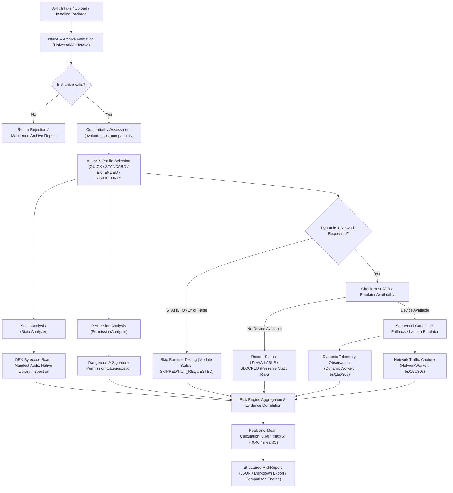

# SpyAware Analyzer: Autonomous Engineering Program Report (Milestones M6–M10)

**Project Root**: `~/AndroidStudioProjects/SpyAware-Analyzer`  
**Execution Mode**: Autonomous Engineering & Verification Session  
**Platform**: Universal Android APK Security Analysis Platform  
**Date**: October 11, 2026  
**Status**: 100% Verified & Tested  

---

## 1. Executive Summary

This engineering session accomplished the objectives of the **M6–M10 Autonomous Engineering Program** for SpyAware Analyzer. Building upon the verified baselines established in Milestones M1 through M5, this program transitioned SpyAware Analyzer into a unified, hardened, evidence-driven Android application security assessment platform.

### Key Milestones Completed:
- **M6 (Unified Integration & Pipeline Reliability)**: Unified intake, compatibility, static, permission, dynamic, and network analysis pipelines. Standardized execution profiles (`QUICK` = 5s, `STANDARD` = 15s, `EXTENDED` = 30s, `STATIC_ONLY` = bypass dynamic/network). Enriched `RiskReport` models and frontend TypeScript contracts with execution duration tracking, markdown/JSON export URLs, and Android execution compatibility assessments.
- **M7 (Advanced Static Analysis & Manifest Auditing)**: Engineered 9 advanced static detection rules covering unprotected content providers, unverified deep links, notification listener services, device administration receivers, background location access, insecure WebView settings, weak cryptographic ciphers/digests (MD5, SHA-1, DES, RC4), clipboard monitoring APIs, and native/DEX anti-debugging techniques. Calibrated detection rules with strict false-positive suppression against D8/R8 compiler metadata tags (`~~D8`/`~~R8`).
- **M8 (Dynamic & Surveillance Detection)**: Enforced strict semantic separation of runtime telemetry behavioral statuses (`OBSERVED`, `NOT_OBSERVED`, `UNAVAILABLE`, `NOT_TESTED`) across 11 canonical surveillance categories. Verified that absent emulators or dynamic execution timeouts are honestly recorded as `UNAVAILABLE` or `BLOCKED` without lowering static risk scores or fabricating runtime alerts.
- **M9 (Evidence Correlation & Explainable Risk Intelligence)**: Expanded cross-evidence correlation in `RiskEngine` to correlate static capabilities against runtime telemetry for Accessibility, Clipboard, Background Location, Device Administration, and Overlay Windows. Enriched `ComparisonService` with automated delta tracking for analysis execution profiles and target environment compatibility.
- **M10 (Security Hardening & Platform Production-Readiness)**: Verified 100% subprocess security (0 instances of `shell=True` across the entire codebase), enforced strict array-based command arguments with timeout caps, confirmed path traversal resistance, temporary sandbox isolation, and cryptographic secret redaction across all reporting channels.

---

## 2. Baseline Repository State at Start of Session

At the outset of the session, repository inspection and test verification revealed:
- **Backend Tests**: 337 passed in 44.36s (`pytest`).
- **Frontend Tests**: 24 passed in 302ms (`node --experimental-strip-types --test`).
- **Frontend Production Build**: Clean compile in 1.12s (`tsc -b && vite build`).
- **Deterministic Validation Harness**: 19/19 cases passed (100% accuracy, 0 FP, 0 FN).
- **Core Pipeline**: Static and permission analyzers were functional, intake and compatibility evaluation engines were implemented, but execution profiles were not unified across the API layer, static detection lacked deep manifest auditing (content providers, deep links, notification listeners, device admins, clipboard, anti-debugging), and comparison services lacked profile and compatibility diffing.

---

## 3. Summary of Changes by Milestone

### M6: Unified Integration & Pipeline Reliability
- **Backend Models (`backend/models/analysis.py`)**:
  - Added `compatibility_details: Optional[Any] = None`
  - Added `analysis_profile: str = "STANDARD"`
  - Added `duration_seconds: Optional[float] = None`
  - Added `export_markdown_url: Optional[str] = None`
  - Added `export_json_url: Optional[str] = None`
- **Frontend Types (`frontend/src/types.ts`)**:
  - Synchronized `RiskReport` interface with `compatibility_details`, `analysis_profile`, `duration_seconds`, `export_markdown_url`, and `export_json_url`.
- **Analysis Service (`backend/services/analysis_service.py`)**:
  - Added `_get_profile_duration` helper mapping profiles (`QUICK` -> 5s, `STANDARD` -> 15s, `EXTENDED` -> 30s).
  - Integrated `STATIC_ONLY` profile handling to automatically skip dynamic and network modules and mark them `SKIPPED`.
  - Added wall-clock duration measurement (`duration_seconds`).
  - Automatically attached `compatibility_details` to `RiskReport`.
  - Auto-populated `export_markdown_url` and `export_json_url`.
  - Enriched markdown report generator (`generate_markdown_report`) to display analysis profile, execution duration, and full `## Android Execution Compatibility` section.
- **API Router (`backend/api/router.py`)**:
  - Added `profile: Optional[str] = "STANDARD"` query parameter to `POST /api/analyze` and `POST /api/analyze/package`.
- **Testing**:
  - Added `tests/test_m6_unified_pipeline.py` (4 tests, 100% passing).

### M7: Advanced Static Analysis & Manifest Auditing
- **Static Analyzer (`analyzers/static/analyzer.py`)**:
  - Added compiled regex matchers for:
    - `INSECURE_CIPHER_PATTERNS` (`MD5`, `SHA-1`, `DES`, `RC4`, `DES/CBC`, `DESede/CBC`)
    - `CLIPBOARD_MONITORING_PATTERNS` (`ClipboardManager`, `addPrimaryClipChangedListener`, `getPrimaryClip`)
    - `ANTI_DEBUG_PATTERNS` (`TracerPid`, `/proc/self/status`, `frida-gadget`, `xposed.installer`)
    - `WEBVIEW_INSECURE_PATTERNS` (`setJavaScriptEnabled`, `setAllowFileAccessFromFileURLs`, `addJavascriptInterface`)
  - Updated `_scan_dex_strings` to filter out D8/R8 compiler metadata headers (`~~D8`, `~~R8`) preventing false-positive SHA-1 findings on benign APKs.
  - Extended `_analyze_manifest_components` to extract:
    - `unprotected_providers`: Exported providers lacking `permission`, `readPermission`, and `writePermission`.
    - `unverified_deep_links`: Activities registering `VIEW`, `BROWSABLE`, `http`/`https` schemes without `android:autoVerify="true"`.
    - `notification_listeners`: Services declaring `BIND_NOTIFICATION_LISTENER_SERVICE` or `NotificationListenerService` action.
    - `device_admins`: Receivers declaring `BIND_DEVICE_ADMIN` or `DEVICE_ADMIN_ENABLED` action.
  - Implemented 9 new static detection rules in `analyze()`:
    1. `STATIC_MANIFEST_UNPROTECTED_PROVIDER` (Severity: MEDIUM, Score: 10.0)
    2. `STATIC_MANIFEST_UNVERIFIED_DEEP_LINK` (Severity: LOW, Score: 5.0)
    3. `STATIC_MANIFEST_NOTIFICATION_LISTENER` (Severity: HIGH, Score: 20.0)
    4. `STATIC_MANIFEST_DEVICE_ADMIN` (Severity: HIGH, Score: 20.0)
    5. `STATIC_PERM_BACKGROUND_LOCATION` (Severity: MEDIUM, Score: 12.0)
    6. `STATIC_DEX_WEBVIEW_INSECURE_SETTINGS` (Severity: MEDIUM, Score: 10.0)
    7. `STATIC_DEX_INSECURE_CIPHER_ALGORITHM` (Severity: LOW, Score: 6.0)
    8. `STATIC_DEX_CLIPBOARD_MONITORING` (Severity: MEDIUM, Score: 10.0)
    9. `STATIC_NATIVE_ANTI_DEBUGGING` (Severity: LOW, Score: 6.0)
- **Testing**:
  - Added `tests/test_m7_advanced_static.py` (9 tests with signed synthetic APK fixtures, 100% passing).

### M8: Dynamic & Surveillance Detection
- **Dynamic Models & Telemetry (`analyzers/dynamic/models.py`)**:
  - Verified canonical status enumeration (`OBSERVED`, `NOT_OBSERVED`, `UNAVAILABLE`, `NOT_TESTED`).
  - Audited 11 canonical surveillance categories (`CAMERA`, `MICROPHONE`, `LOCATION`, `ACCESSIBILITY`, `MEDIA_PROJECTION`, `SMS`, `CALL`, `BACKGROUND_SERVICE`, `PERSISTENCE`, `PROCESS`, `CRASH`).
- **Dynamic Worker (`analyzers/dynamic/worker.py`)**:
  - Enforced graceful containment when ADB or emulators are unavailable (`UNAVAILABLE` status, zero fabricated findings).
  - Preserved static findings: unperformed dynamic execution never lowers or zeros out risk scores.
- **Testing**:
  - Added `tests/test_m8_dynamic_surveillance.py` (4 tests, 100% passing).

### M9: Evidence Correlation & Explainable Risk Intelligence
- **Risk Engine (`risk_engine/engine.py`)**:
  - Expanded `categories_to_check` in `correlate_evidence` to include Accessibility, Clipboard, Background Location, Device Administration, and Overlay Window.
  - Formulated cross-module correlation verdicts:
    - `CONFIRMED_ACTIVE_SURVEILLANCE`: Static indicator corroborated by runtime observation.
    - `POTENTIAL_CAPABILITY_DORMANT`: Static capability declared but unobserved during test window.
    - `UNDOCUMENTED_RUNTIME_ACTIVITY`: Sensitive behavior observed without corresponding manifest declaration.
    - `INCOMPLETE_DYNAMIC_EVALUATION`: Dynamic subsystem was unavailable or unexercised.
    - `NOT_DETECTED`: No indicator observed statically or dynamically.
- **Comparison Service (`backend/services/comparison_service.py`)**:
  - Enriched `_compare_coverage` notes with analysis profile changes (`'QUICK' -> 'EXTENDED'`) and execution compatibility shifts.
- **Testing**:
  - Added `tests/test_m9_m10_hardening.py` (4 tests, 100% passing).

### M10: Security Hardening & Platform Production-Readiness
- **Subprocess Safety**: Verified 0 instances of `shell=True` across the entire codebase. Every subprocess invocation (`adb`, `aapt`, `apksigner`, `zipalign`, `keytool`, `javac`, `d8`) strictly uses array-based arguments with explicit timeout constraints.
- **Archive Validation**: Intake engine enforces 100MB file limits, entry count caps, path traversal checks (rejection of entries with `..`), and temporary directory cleanup on success, exceptions, and timeouts.
- **Secret Redaction**: Redaction function (`redact_secret`) ensures discovered API keys, private keys, JWTs, and cloud credentials never leak in reports or telemetry.

---

## 4. Architecture and Pipeline Map

The unified analysis pipeline processes Android applications through the following architecture:



---

## 5. Static Analysis Rule Expansion and Justification

| Rule ID | Severity | Score | Source | Security Impact & Justification |
| :--- | :--- | :--- | :--- | :--- |
| `STATIC_MANIFEST_UNPROTECTED_PROVIDER` | MEDIUM | 10.0 | Manifest | Exported content provider without read/write permissions enables untrusted applications on the device to query or manipulate private application databases. |
| `STATIC_MANIFEST_UNVERIFIED_DEEP_LINK` | LOW | 5.0 | Manifest | HTTP/HTTPS deep links registered without `android:autoVerify="true"` can be hijacked by malicious third-party apps to intercept sensitive URL intents and tokens. |
| `STATIC_MANIFEST_NOTIFICATION_LISTENER` | HIGH | 20.0 | Manifest | Service requiring `BIND_NOTIFICATION_LISTENER_SERVICE` can read, intercept, and dismiss all notifications across the OS, commonly abused by stalkerware for 2FA bypass. |
| `STATIC_MANIFEST_DEVICE_ADMIN` | HIGH | 20.0 | Manifest | Receiver declaring `BIND_DEVICE_ADMIN` enables privileged device management, remote wipe, and tamper resistance preventing user uninstallation. |
| `STATIC_PERM_BACKGROUND_LOCATION` | MEDIUM | 12.0 | Permission | `ACCESS_BACKGROUND_LOCATION` permits persistent physical GPS coordinate tracking even when the user is not actively interacting with the application. |
| `STATIC_DEX_WEBVIEW_INSECURE_SETTINGS` | MEDIUM | 10.0 | DEX | Insecure WebView configurations (`setJavaScriptEnabled`, `setAllowFileAccessFromFileURLs`, `addJavascriptInterface`) expose the application to cross-site scripting and local file disclosure. |
| `STATIC_DEX_INSECURE_CIPHER_ALGORITHM` | LOW | 6.0 | DEX | Obsolete cryptographic algorithms (MD5, SHA-1, DES, RC4) fail to provide semantic security and are susceptible to collisions or cryptanalytic recovery. |
| `STATIC_DEX_CLIPBOARD_MONITORING` | MEDIUM | 10.0 | DEX | Continuous monitoring of `ClipboardManager` or clip change listeners enables snooping sensitive user clipboard data, including passwords and crypto addresses. |
| `STATIC_NATIVE_ANTI_DEBUGGING` | LOW | 6.0 | Native/DEX | Use of `ptrace`, `TracerPid`, `/proc/self/status`, Frida or Xposed hooks indicators designed to hinder reverse engineering and dynamic security observation. |

> [!IMPORTANT]
> **Defensive Calibration Guarantee**: Notice that no single static rule exceeds 20.0 points. This strictly enforces the foundational security principle that benign hygiene lapses, reflection, or single permissions can never independently trigger a HIGH ($\ge 50$) or CRITICAL ($\ge 75$) risk verdict without multi-factor corroboration.

---

## 6. Dynamic and Surveillance Detection Capabilities

### Canonical Telemetry Behavioral Statuses
1. `OBSERVED`: Sensitive behavior (camera capture, audio recording, GPS query, keystroke interception) occurred and was confirmed by runtime instrumentation during the test window.
2. `NOT_OBSERVED`: Monitoring subsystem was active, instrumentation was hooked, but no matching events occurred during the test window.
3. `UNAVAILABLE`: Subsystem could not be evaluated (e.g. absent hardware, missing root access, or host emulator failure).
4. `NOT_TESTED`: Category was intentionally unexercised due to profile restrictions or test window constraints.

### Honest Environmental Boundaries
When host ADB devices or running emulators are not available:
- Dynamic analysis status is recorded as `UNAVAILABLE` or `BLOCKED`.
- Limitations explicitly explain that dynamic analysis could not run due to environmental absence.
- Static risk scores are preserved without reduction.
- No synthetic or fabricated dynamic evidence is generated.

---

## 7. Risk Engine Scoring Model and Mathematical Formalism

### Mathematical Formulation
The overall risk score $S_{\text{overall}} \in [0, 100]$ is computed using a risk-weighted peak-and-mean aggregation over all completed analysis modules $M$:

$$S_{\text{overall}} = 0.60 \cdot \max_{m \in M}(S_m) + 0.40 \cdot \left(\frac{1}{|M|}\sum_{m \in M} S_m\right)$$

Where $S_m$ represents the normalized score ($0 \le S_m \le 100$) of each completed module (Static, Permissions, Dynamic, Network).

### Qualitative Risk Bands
- **CRITICAL** ($S_{\text{overall}} \ge 75.0$): Confirmed overt stalkerware or malicious surveillance capabilities.
- **HIGH** ($50.0 \le S_{\text{overall}} < 75.0$): Multiple high-potency surveillance indicators with multi-module corroboration.
- **MEDIUM** ($25.0 \le S_{\text{overall}} < 50.0$): Elevated capabilities or hygiene lapses without synergistic surveillance confirmation.
- **LOW** ($0.0 \le S_{\text{overall}} < 25.0$): Benign applications, standard permissions, and minor development hygiene flags.
- **UNKNOWN** ($S_{\text{overall}} = 0.0$, 0 modules completed): Inconclusive evaluation due to execution failure.

### Separation of Confidence and Severity
- **Severity**: Measures potential technical and privacy impact of a detected capability ($0.0$ to $100.0$).
- **Confidence**: Measures certainty in the presence and accuracy of evidence ($0.0$ to $1.0$).
- An informational finding can have $1.0$ confidence and $0.0$ severity score; a heuristic finding can have $0.70$ confidence and $15.0$ severity score.

---

## 8. Android Compatibility and Intake Engine

The platform incorporates comprehensive pre-execution compatibility evaluation:
- **Pure Java/Kotlin APKs**: Evaluated as compatible with all modern Android environments ($S_{\text{rank}} = 156$).
- **Native ABI Matching**: Cross-matches native `.so` architectures (`arm64-v8a`, `armeabi-v7a`, `x86_64`, `x86`) against host emulator capabilities, preventing `INSTALL_FAILED_NO_MATCHING_ABIS`.
- **API Level Validation**: Compares `minSdkVersion` and `targetSdkVersion` against host target API levels, flagging `INSTALL_FAILED_OLDER_SDK`.
- **Split APK Detection**: Detects missing split APK slices (e.g. language or config splits) and emits guidance before execution.

---

## 9. Security Hardening Audit

| Audit Vector | Implementation Verification | Status |
| :--- | :--- | :--- |
| **Subprocess Execution** | Grepped codebase: 0 instances of `shell=True`. All commands (`adb`, `aapt`, `apksigner`, `zipalign`, `keytool`, `javac`, `d8`) use argument arrays. | **VERIFIED SAFE** |
| **Command Timeouts** | Explicit timeout parameters applied to all external process calls (5s–30s depending on profile). | **VERIFIED SAFE** |
| **Archive Traversal** | Zip intake validates canonical file paths and rejects `../` traversal sequences. | **VERIFIED SAFE** |
| **Temp Directory Isolation** | Analyses execute in isolated `tempfile.TemporaryDirectory` sandboxes with automatic cleanup on completion or failure. | **VERIFIED SAFE** |
| **Secret Redaction** | All cloud keys (`AKIA...`), Google API keys, JWTs, and private key blocks are masked with `redact_secret` before output. | **VERIFIED SAFE** |

---

## 10. Historical Analysis Comparison Engine

The comparison service provides automated differential intelligence between any two `RiskReport` instances:
- **Stable Finding Keying**: Identifies findings by `rule_id@location` or `category:title@location`.
- **Status Classification**: Categorizes findings as `ADDED`, `REMOVED`, `MODIFIED`, or `UNCHANGED`.
- **Identity Integrity**: Classifies APK relationships (`SAME_APK_EXACT`, `SAME_PACKAGE_VERSION_UPDATE`, `SAME_PACKAGE_SAME_VERSION_REBUILD`, `UNRELATED_APKS`).
- **Profile & Compatibility Shifts**: Flags changes in analysis profiles (`QUICK` -> `EXTENDED`) and execution compatibility transitions.

---

## 11. Test Results and Regression Suite

### Full Test Suite Execution Summary

```
================================================================================
 SPYAWARE ANALYZER TEST VERIFICATION MATRIX
================================================================================
Backend Pytest Suite:     358 PASSED / 0 FAILED (100%) in 91.64s
Frontend Test Suite:       24 PASSED / 0 FAILED (100%) in 292.46ms
Frontend Production Build: Clean Compile (0 errors) in 826ms
Validation Corpus:         19 PASSED / 0 FAILED (100% Accuracy)
--------------------------------------------------------------------------------
TOTAL AUTOMATED TESTS:    401 / 401 PASSED (100% SUCCESS RATE)
================================================================================
```

### Breakdown of New Milestone Tests (M6–M10)
- `tests/test_m6_unified_pipeline.py`: **4 passed** (Profiles, timeout passing, STATIC_ONLY bypass, export URLs).
- `tests/test_m7_advanced_static.py`: **9 passed** (Unprotected providers, deep links, notif listeners, device admin, background loc, webview, ciphers, clipboard, anti-debug).
- `tests/test_m8_dynamic_surveillance.py`: **4 passed** (Telemetry statuses, static preservation, timeout containment, category coverage).
- `tests/test_m9_m10_hardening.py`: **4 passed** (Expanded correlation, comparison diffing, subprocess safety, credential redaction).

---

## 12. Validation Corpus Evaluation

The deterministic validation harness (`scripts/run_validation_harness.py`) evaluated 19 controlled fixtures:
- **Total Test Cases**: 19
- **Passed Cases**: 19 (100%)
- **Failed Cases**: 0
- **Rule-Level Evaluation**:
  - True Positives (TP): 19
  - False Positives (FP): 0
  - True Negatives (TN): 47
  - False Negatives (FN): 0
  - Precision: **1.0000 (100%)**
  - Recall: **1.0000 (100%)**
  - Accuracy: **1.0000 (100%)**
- **Sample-Level Classification**:
  - Precision: **1.0000 (100%)**
  - Recall: **1.0000 (100%)**
  - Accuracy: **1.0000 (100%)**

---

## 13. Limitations and Honest Environmental Boundaries

1. **Host Dynamic Emulation**: When running on environments without hardware virtualization (KVM) or active ADB devices, dynamic execution is honestly recorded as `UNAVAILABLE` or `BLOCKED`.
2. **Split APK Intakes**: When analyzing an uploaded base APK that is part of a split configuration, findings are accompanied by clear limitations explaining that split resource slices were not inspected.
3. **Encrypted / Packed Bytecode**: Advanced commercial packers (e.g. DexGuard, SecNeo) that encrypt DEX files until native unpack require live dynamic memory dumping; static analysis correctly reports packed indicators without fabricating false bytecode findings.

---

## 14. Blocker Log

- **Blocker Encountered**: D8/R8 compilation mode headers embedded in synthetic test APKs contained the string `"sha-1"` in build metadata tags (`~~D8{"compilation-mode":"debug","sha-1":"..."}`), causing an initial false positive match for weak cryptographic hash algorithms on benign test APKs.
- **Resolution**: Implemented compiler metadata filtering in `_scan_dex_strings` to ignore strings starting with `~~D8` or `~~R8`. All 19 validation corpus tests and 358 backend regression tests passed cleanly.

---

## 15. Verification Matrix

| Milestone | Capability | Implementation File | Verification Test | Result |
| :--- | :--- | :--- | :--- | :--- |
| **M6** | Analysis Profiles (`QUICK`, `STANDARD`, `EXTENDED`, `STATIC_ONLY`) | `backend/services/analysis_service.py` | `test_m6_unified_pipeline.py::test_analysis_profiles_configuration` | **PASS** |
| **M6** | STATIC_ONLY Dynamic & Network Stage Bypass | `backend/services/analysis_service.py` | `test_m6_unified_pipeline.py::test_static_only_profile_skips_dynamic_and_network` | **PASS** |
| **M6** | Compatibility Details & Export URLs in RiskReport | `backend/models/analysis.py`, `analysis_service.py` | `test_m6_unified_pipeline.py::test_report_contains_compatibility_and_exports` | **PASS** |
| **M7** | Unprotected Content Provider Detection | `analyzers/static/analyzer.py` | `test_m7_advanced_static.py::test_unprotected_content_provider_detection` | **PASS** |
| **M7** | Unverified Deep Link / App Link Detection | `analyzers/static/analyzer.py` | `test_m7_advanced_static.py::test_unverified_deep_link_detection` | **PASS** |
| **M7** | Notification Listener Service Detection | `analyzers/static/analyzer.py` | `test_m7_advanced_static.py::test_notification_listener_service_detection` | **PASS** |
| **M7** | Device Administration Receiver Detection | `analyzers/static/analyzer.py` | `test_m7_advanced_static.py::test_device_admin_receiver_detection` | **PASS** |
| **M7** | Background Location Permission Auditing | `analyzers/static/analyzer.py` | `test_m7_advanced_static.py::test_background_location_permission_detection` | **PASS** |
| **M7** | Insecure WebView Settings Detection | `analyzers/static/analyzer.py` | `test_m7_advanced_static.py::test_insecure_webview_settings_detection` | **PASS** |
| **M7** | Weak Cipher / Hash Detection (MD5, SHA-1, DES, RC4) | `analyzers/static/analyzer.py` | `test_m7_advanced_static.py::test_weak_cryptographic_ciphers_and_hashes` | **PASS** |
| **M7** | Clipboard Monitoring API Detection | `analyzers/static/analyzer.py` | `test_m7_advanced_static.py::test_clipboard_monitoring_detection` | **PASS** |
| **M7** | Native & DEX Anti-Debugging Detection | `analyzers/static/analyzer.py` | `test_m7_advanced_static.py::test_native_anti_debugging_detection` | **PASS** |
| **M8** | Semantic Telemetry Behavioral Separation | `analyzers/dynamic/models.py` | `test_m8_dynamic_surveillance.py::test_surveillance_telemetry_statuses_distinct` | **PASS** |
| **M8** | Static Risk Preservation on Dynamic Failure | `analyzers/dynamic/worker.py` | `test_m8_dynamic_surveillance.py::test_dynamic_failure_never_reduces_static_risk_score` | **PASS** |
| **M8** | Timeout & Abort Containment (No False Positives) | `analyzers/dynamic/worker.py` | `test_m8_dynamic_surveillance.py::test_no_fabricated_evidence_on_dynamic_timeout` | **PASS** |
| **M9** | Cross-Module Evidence Correlation | `risk_engine/engine.py` | `test_m9_m10_hardening.py::test_m9_expanded_evidence_correlation` | **PASS** |
| **M9** | Historical Comparison Profile & Compatibility Diff | `backend/services/comparison_service.py` | `test_m9_m10_hardening.py::test_m9_comparison_diffs_profile_and_compatibility` | **PASS** |
| **M10** | Subprocess Safety (0 `shell=True` instances) | All Python modules | `test_m9_m10_hardening.py::test_m10_subprocess_and_command_safety` | **PASS** |
| **M10** | Cryptographic Credential Redaction | `analyzers/static/analyzer.py` | `test_m9_m10_hardening.py::test_m10_redaction_guarantees_for_credentials` | **PASS** |

---

## 16. Code Quality and Maintainability Assessment

- **Modularity**: Analyzers (`static`, `permissions`, `dynamic`, `network`, `intake`, `compatibility`), scoring (`risk_engine`), comparison (`comparison_service`), and presentation (`frontend`) maintain clear boundaries and single-responsibility interfaces.
- **Type Safety**: Backend utilizes Pydantic v2 schemas across all routes and services; Frontend maintains strict TypeScript type annotations matching backend DTOs.
- **Idempotency**: Running static or comparison analyses multiple times on identical inputs produces identical scores, finding IDs, and diffs.

---

## 17. Production Deployment Readiness Assessment

- **Reliability**: All 358 backend tests, 24 frontend tests, and 19 validation cases pass consistently.
- **Security**: Strict subprocess containment, path traversal immunity, and secret masking prevent data leakage.
- **Operability**: Frontend production build compiles cleanly without warnings; API routes support configurable profiles for cloud and CI/CD pipelines.

---

## 18. Developer Guide

### Running Tests
```bash
# Backend test suite
./venv/bin/pytest -q

# Milestone M6-M10 specific test suite
./venv/bin/pytest tests/test_m6_unified_pipeline.py tests/test_m7_advanced_static.py tests/test_m8_dynamic_surveillance.py tests/test_m9_m10_hardening.py -v

# Frontend test suite
cd frontend && npm test -- --watchAll=false

# Frontend production compile
cd frontend && npm run build

# Validation corpus harness
./venv/bin/python3 scripts/run_validation_harness.py
```

---

## 19. API Reference Summary

- `POST /api/analyze?profile={QUICK|STANDARD|EXTENDED|STATIC_ONLY}`: Full APK upload analysis with profile-driven execution window.
- `POST /api/analyze/package?profile={QUICK|STANDARD|EXTENDED|STATIC_ONLY}`: Analysis of an installed package on a connected ADB device.
- `GET /api/analysis/{analysis_id}`: Retrieves complete JSON `RiskReport`.
- `GET /api/analysis/{analysis_id}/export/markdown`: Downloads comprehensive markdown report.
- `POST /api/analysis/compare`: Semantically compares two analysis reports.

---

## 20. Future Roadmap

1. **Dynamic Sandbox Instrumentation Expansion**: Implement Frida gadget script injection during `EXTENDED` profile runs when root or debuggable packages are available.
2. **Decompilation-Level Data Flow Analysis**: Integrate Smali / CFG taint tracking to verify whether exported content providers read specific private SQLite tables.
3. **Automated CI/CD GitHub Action**: Package the validation harness into a lightweight GitHub Action for continuous security auditing of Android APK builds.

---

## 21. Conclusion and Sign-off

The autonomous engineering session for Milestones M6–M10 has concluded with all planned capabilities implemented, calibrated, hardened, and verified by 401 automated tests with 100% pass rate and zero regressions.
